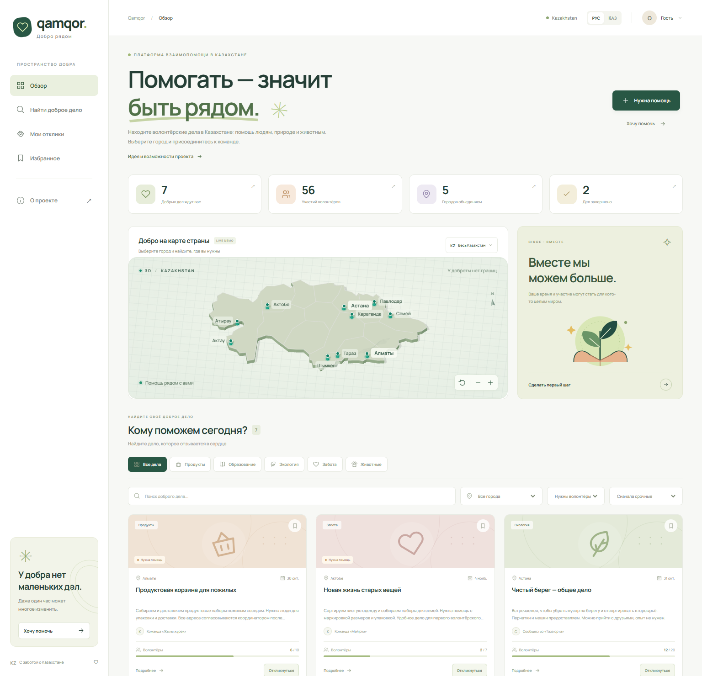

# Qamqor · помощь рядом

**Найти полезное дело в своём городе и присоединиться к нему за несколько шагов.**

Qamqor — платформа волонтёрских инициатив в Казахстане на **Angular и Java**. Она собирает в одном месте задачи, которые обычно теряются в чатах: помощь пожилым, экологические акции, занятия с детьми и поддержка животных. Волонтёр видит, **где, когда и какая помощь нужна**, а организатор может создать инициативу и набрать участников.

[Открыть интерактивную демоверсию →](https://alikhan005.github.io/qamqor/)

[Посмотреть проект за 60 секунд](docs/DEMO.md) · [Архитектура и API](docs/ARCHITECTURE.md) · [Результаты проверок](docs/VERIFICATION.md)



`Angular 21` · `TypeScript` · `Three.js` · `Java 21` · `Spring Boot 3.5.16` · `Spring Data JPA` · `H2 / PostgreSQL` · `Docker`

## Как работает проект

1. **Найти дело.** Выберите город на 3D-карте Казахстана или в фильтре, затем категорию помощи.
2. **Присоединиться.** Откройте инициативу, посмотрите задачу, место, дату и свободные места, затем оставьте демонстрационный отклик.
3. **Вернуться к выбранному.** Сохраните инициативу в избранное и откройте «Мои отклики». Результат остаётся после обновления страницы.

Организатор может создать свою инициативу через форму. Интерфейс доступен на русском и казахском языках, работает на компьютере и телефоне. Каталог можно использовать независимо от 3D-карты; при отсутствии WebGL предусмотрен SVG-режим.

Это проект для портфолио с вымышленными инициативами и участниками. Счётчики показывают демонстрационные данные; реальная помощь и аудитория не измерялись.

## Что можно оценить в коде

| Область | Реализация |
| --- | --- |
| Frontend | Standalone-компоненты Angular, TypeScript, signals, формы с проверкой полей, поиск и сочетание фильтров |
| 3D и доступность | Сцена Three.js, выбор города, SVG-резерв, управление с клавиатуры, адаптивная вёрстка |
| Backend | Java 21, Spring Boot 3.5.16, REST, DTO, Bean Validation, бизнес-логика участия |
| Хранение | Spring Data JPA, файловая H2 по умолчанию, профиль PostgreSQL |
| Проверки | 7 интеграционных Java-тестов, 11 автономных браузерных сценариев и 1 дополнительный сценарий с Java API |
| Поставка | Production-сборки Angular, Docker Compose, GitHub Actions, документация API и воспроизводимые команды |

API проверяет вместимость инициативы, повторный отклик, статус и входные данные. Интеграционные тесты включают одновременную запись участников, чтобы проверить соблюдение вместимости. Подробнее — в [отчёте о проверке](docs/VERIFICATION.md).

## Два режима

**Публичное демо** открывается в браузере и позволяет попробовать поиск, создание инициативы, избранное и отклики. Изменения хранятся в `localStorage` текущего браузера и не видны другим посетителям. Для просмотра демо устанавливать Java не нужно.

**Полный стек** использует настоящий Java REST API и базу данных. Инициативы и записи участников сохраняются сервером. Избранное и список собственных откликов остаются локальными отметками браузера. Демоданные браузера и серверная база используются отдельно; автоматического переноса между ними нет.

В текущей версии нет регистрации, проверки организаторов и модерации. Для демонстрации используйте вымышленные данные. Авторизация, роли и модерация — следующие этапы развития проекта.

## Локальный запуск

Команды выполняются из корня проекта. Нужен **Node.js 22.12+**; для backend также нужны **JDK 21** и **Maven 3.9+**.

### Интерфейс с демоданными

```sh
cd frontend
npm ci
npm start
```

Откройте **http://localhost:4200**.

### Angular + Java + база

В первом терминале:

```sh
cd backend
mvn spring-boot:run
```

Во втором терминале:

```sh
cd frontend
npm ci
npm run start:api
```

Откройте **http://localhost:4200**. Dev server направляет `/api` на **http://localhost:8080**. Данные API сохраняются в файловой H2 в `backend/data/`. Остановка — `Ctrl+C`.

### Скрипты Windows

После `npm ci` в `frontend/` демо можно запустить из корня проекта:

```powershell
.\scripts\start-demo.ps1
```

Для backend:

```powershell
.\scripts\start-backend.ps1
```

Скрипт backend ищет готовые JDK 21 и Maven в `.tools/` проекта или родительской папки, затем использует `JAVA_HOME` и Maven из `PATH`. На свежем клоне установите эти инструменты самостоятельно. Для полного режима оставьте backend работающим и запустите `npm run start:api` из `frontend/` в другом терминале.

### Docker

Нужен Docker с Compose v2:

```sh
docker compose up --build
```

Откройте **http://localhost:8081**. Nginx раздаёт Angular и передаёт `/api` Java-приложению. API также доступен на **http://localhost:8080/api/requests**. H2 сохраняется в томе `qamqor-data`.

```sh
docker compose down
```

Эта команда останавливает приложение и сохраняет том с данными. Docker и PostgreSQL подготовлены в конфигурации; их запуск не входил в выполненные локальные проверки.

## Проверка проекта

Frontend:

```sh
cd frontend
npm ci
npm run check
npm run build
npm run build:api
```

Backend в отдельном терминале:

```sh
cd backend
mvn test
```

Браузерные сценарии из `frontend/`:

```sh
npx playwright install chromium
npm run test:e2e
```

Playwright запускает dev server на порту 4200. Дополнительный сценарий с Java API включается отдельно; команды, условия и результаты находятся в [VERIFICATION.md](docs/VERIFICATION.md). GitHub Actions описан в [`.github/workflows/ci.yml`](.github/workflows/ci.yml).

## Структура

```text
qamqor/
├── frontend/                Angular, Three.js, деморежим и API-клиент
├── backend/                 Spring Boot, REST, JPA, валидация
├── docs/
│   ├── ARCHITECTURE.md       Устройство приложения и контракт API
│   ├── DEMO.md               Показ проекта за 60 секунд
│   ├── GITHUB.md             Ссылки и оформление проекта в профиле
│   └── VERIFICATION.md       Результаты проверок и команды
├── .github/workflows/       Сборка, тесты и публикация
└── docker-compose.yml       Angular + Java с постоянным хранилищем
```

Manrope поставляется внутри сборки через Fontsource. Карта, иконки и иллюстрации создаются кодом, без внешних изображений и шрифтов с CDN.

## PostgreSQL

По умолчанию дополнительная настройка базы не нужна. Для существующего PostgreSQL задайте переменные перед запуском из `backend/`:

```powershell
$env:SPRING_PROFILES_ACTIVE = "postgres"
$env:DB_URL = "jdbc:postgresql://localhost:5432/qamqor"
$env:DB_USERNAME = "qamqor"
$env:DB_PASSWORD = "replace-with-your-local-password"
mvn spring-boot:run
```

База и пользователь должны существовать. Пароль хранится в окружении и не добавляется в Git. Docker Compose этого репозитория использует H2.

## Материалы для портфолио

[Сценарий показа и описание для резюме](docs/DEMO.md) · [Как закрепить проект в GitHub и сохранить демо](docs/GITHUB.md) · [Мобильный скриншот](docs/images/mobile.png)

Для обновления скриншотов запустите приложение на порту 4200 и выполните `npm run screenshot` из `frontend/`. По умолчанию нужен установленный Chrome; настройка другого канала описана в [VERIFICATION.md](docs/VERIFICATION.md).

Для сборки архива исходников выполните `python scripts/package-source.py` из корня. Архив `qamqor-source.zip` появится рядом с папкой проекта; зависимости, базы и результаты сборки в него не входят.

Код распространяется по [лицензии MIT](LICENSE).

