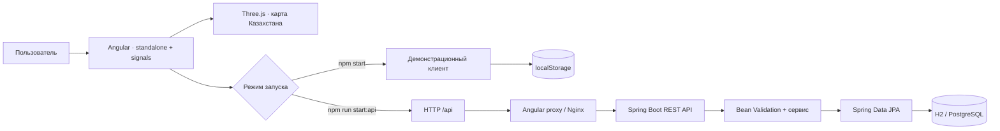

# Архитектура Qamqor

Qamqor — приложение для демонстрации локальных волонтёрских инициатив в Казахстане. Оно показывает полный пользовательский сценарий, а также разделение интерфейса, API и хранения данных.

## Два режима данных



В автономном режиме данные сохраняются только в браузере. В API-режиме Java отвечает за состояние; `localStorage` не заменяет серверную базу и не служит резервной копией API.

Избранное, отображаемое имя и список собственных откликов сохраняются локально в обоих режимах. Это удобство интерфейса, а не серверная авторизация. Название и описание инициативы остаются пользовательским текстом; переключатель RU/KK переводит интерфейс, а не содержимое каждой заявки.

Во время локальной разработки Angular proxy направляет `/api` на `localhost:8080`. В Docker Nginx направляет тот же путь сервису `backend:8080`, поэтому браузеру достаточно одного origin.

## Ответственность частей

| Часть | Ответственность |
| --- | --- |
| Angular | Навигация, фильтры, формы, состояние интерфейса, отображение ошибок |
| Three.js | Визуализация Казахстана и интерактивные маркеры городов |
| Клиент данных | Единый пользовательский сценарий в автономном и API-режимах |
| REST-контроллер | HTTP-маршруты и проверка входных DTO |
| Сервис | Создание инициатив, участие, правила изменения данных |
| JPA | Сохранение инициатив и записей участия |
| H2 / PostgreSQL | Постоянное хранение в полном режиме |

Статистика вычисляется из данных приложения. Она описывает демо-набор, а не подтверждённые результаты реального волонтёрского сервиса.

## Модель инициативы

| Поле | Тип | Назначение |
| --- | --- | --- |
| `id` | string UUID | Идентификатор, присваиваемый сервером |
| `title` | string | Краткое название задачи |
| `description` | string | Что нужно сделать и кому это помогает |
| `city` | string | Город Казахстана |
| `category` | enum | `FOOD`, `EDUCATION`, `ECOLOGY`, `CARE`, `ANIMALS` |
| `urgency` | enum | `NORMAL`, `URGENT` |
| `status` | enum | `OPEN`, `COMPLETED` |
| `organizer` | string | Отображаемое имя организатора |
| `volunteers` | integer | Количество участников |
| `targetVolunteers` | integer | Требуемое количество участников |
| `date` | string | Календарная дата в формате `YYYY-MM-DD` |
| `location` | string | Понятное описание места встречи |
| `createdAt` | string ISO 8601 | Время создания для сортировки новых инициатив |

Дата инициативы не содержит часовой пояс или время суток. Вымышленные имена и места из seed-данных не следует трактовать как реальные объявления.

## Контракт API

Базовый путь — `/api`. Тела запросов и ответов используют JSON и `Content-Type: application/json`. При работе через Angular proxy или Nginx клиент отправляет относительные URL.

| Метод | Путь | Результат |
| --- | --- | --- |
| `GET` | `/requests` | Массив инициатив с учётом фильтров |
| `GET` | `/requests/{id}` | Одна инициатива |
| `POST` | `/requests` | `201 Created`, созданная инициатива и заголовок `Location` |
| `POST` | `/requests/{id}/volunteer` | Инициатива после записи участника |
| `GET` | `/stats` | Общая статистика |

### Поиск и фильтрация

```http
GET /api/requests?q=парк&city=Алматы&category=ECOLOGY&status=OPEN
```

Все параметры необязательны и объединяются условием «И». `q` ищет подстроку в названии, описании и имени организатора без учёта регистра. `city` — точное название города без учёта регистра. `category` и `status` принимают значения перечислений из модели. При вызове API программно кодируйте кириллицу как URL-параметры. Пустой результат — пустой массив.

Пример одной инициативы:

```json
{
  "id": "0254915d-14b5-4fc2-9ec4-c847b4e611db",
  "title": "Субботник у реки",
  "description": "Вымышленная инициатива для демонстрации приложения.",
  "city": "Алматы",
  "category": "ECOLOGY",
  "urgency": "NORMAL",
  "status": "OPEN",
  "organizer": "Демо-команда",
  "volunteers": 3,
  "targetVolunteers": 12,
  "date": "2027-05-22",
  "location": "Демонстрационная точка встречи",
  "createdAt": "2026-10-28T10:00:00Z"
}
```

Это пример формы ответа. Идентификаторы и значения счётчиков в запущенном приложении могут отличаться.

### Создание инициативы

```http
POST /api/requests
Content-Type: application/json
```

```json
{
  "title": "Субботник у реки",
  "description": "Вымышленная инициатива для проверки создания задачи.",
  "city": "Алматы",
  "category": "ECOLOGY",
  "urgency": "NORMAL",
  "organizer": "Демо-команда",
  "targetVolunteers": 12,
  "date": "2027-05-22",
  "location": "Демонстрационная точка встречи"
}
```

Клиент не назначает `id`, `status` или текущий счётчик `volunteers`. Сервер проверяет входные поля и возвращает сохранённую инициативу. Пробелы по краям строк удаляются перед проверкой.

| Поле | Проверка |
| --- | --- |
| `title` | 8–140 символов |
| `description` | 20–2000 символов |
| `city` | 2–80 символов |
| `organizer` | 3–100 символов |
| `location` | 5–200 символов |
| `targetVolunteers` | Целое число от 1 до 200 |
| `date` | Сегодня или будущая дата |
| `category`, `urgency` | Обязательные значения соответствующих перечислений |

Дата в примере условная: при повторении запроса выберите актуальную дату в будущем.

### Участие

```http
POST /api/requests/{id}/volunteer
Content-Type: application/json
```

```json
{
  "name": "Демо-волонтёр"
}
```

Имя должно содержать 2–100 символов; пробелы по краям удаляются, повторные пробелы внутри сводятся к одному. Повторная запись с тем же именем в ту же инициативу без учёта регистра возвращает `409 Conflict`. Закрытая инициатива и исчерпанный набор также возвращают `409`. Сервер блокирует строку инициативы на время регистрации, чтобы параллельные запросы не превысили лимит. Успех — `200 OK` с обновлённой инициативой.

Публичный API не возвращает имена записавшихся волонтёров. Имя здесь — демонстрационный ввод. В текущей версии нет учётных записей и подтверждения личности; этот сценарий нельзя использовать как систему доверия к реальным участникам.

### Статистика

```http
GET /api/stats
```

```json
{
  "activeRequests": 8,
  "volunteers": 42,
  "cities": 6,
  "completedRequests": 2
}
```

Числа приведены только как пример структуры. В API они вычисляются из текущей базы: `activeRequests` считает открытые инициативы, `completedRequests` — завершённые, `volunteers` — участие во всех инициативах, `cities` — уникальные города среди всех инициатив.

### Ошибки

Ошибки возвращаются в формате Problem Detail. Некорректный JSON, неизвестное значение перечисления или неверный формат UUID дают `400`; корректный UUID отсутствующей инициативы — `404`. Конфликт участия — `409`.

```json
{
  "type": "about:blank",
  "title": "Bad Request",
  "status": 400,
  "detail": "Описание ошибки",
  "instance": "/api/requests",
  "fieldErrors": {
    "title": "Сообщение проверки поля"
  }
}
```

`fieldErrors` присутствует при ошибке проверки полей; конкретный текст сообщения может отличаться. Клиенту следует опираться на HTTP-статус и имя поля, а не сравнивать текст ошибки.

## Хранение и конфигурация

По умолчанию backend использует файловую H2: `./data/qamqor` относительно рабочего каталога. При `mvn spring-boot:run` из `backend/` данные появляются в `backend/data/`. В Compose рабочий каталог контейнера — `/app`, база находится в именованном томе, подключённом к `/app/data`.

| Переменная | Назначение |
| --- | --- |
| `SPRING_DATASOURCE_URL` | Переопределяет JDBC URL, например путь к H2 в контейнере |
| `SPRING_PROFILES_ACTIVE=postgres` | Включает конфигурацию PostgreSQL |
| `DB_URL` | PostgreSQL JDBC URL |
| `DB_USERNAME` | Пользователь PostgreSQL |
| `DB_PASSWORD` | Пароль PostgreSQL |
| `CORS_ORIGINS` | Разрешённые origin через запятую при прямых запросах к backend |

Секреты задаются окружением. Файлы базы, `.env`, журналы, артефакты сборки и зависимости исключены из Git.

## Следующие этапы

Для развития проекта полезны миграции схемы, авторизация и роли, модерация инициатив, подтверждение организаторов и договорённости об обработке данных. Реальное внедрение также потребует согласования с организациями и проверки доступности интерфейса на устройствах целевой аудитории. Эти возможности не входят в текущую демонстрацию.

